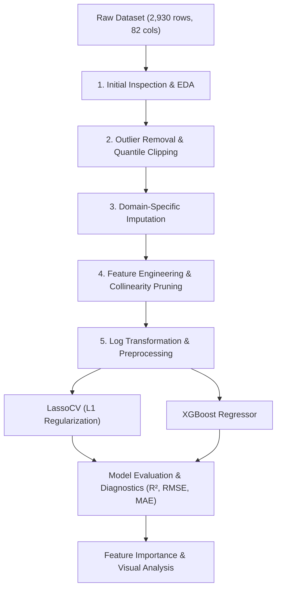

# 🏡 Ames Housing Price Prediction: End-to-End ML Pipeline

[](https://www.python.org/)
[](https://jupyter.org/)
[](https://scikit-learn.org/)
[](https://xgboost.readthedocs.io/)
[](https://opensource.org/licenses/MIT)

An end-to-end Machine Learning project predicting residential home sale prices using the comprehensive **Ames Housing Dataset** (2,930 observations across 82 property attributes). 

This project demonstrates a rigorous data science workflow—from deep exploratory data analysis and domain-aware imputation to creative feature engineering, regularized linear modeling, and gradient boosting.

---

## 📌 Project Overview

Predicting property values requires understanding complex non-linear relationships, multi-collinearity among structural dimensions, and categorical architectural features. 

### Key Highlights:
- **Comprehensive Data Cleaning:** Handled structural missing values vs. missing-at-random values based on domain logic.
- **Outlier Mitigation:** Identified and removed influential anomalies (e.g., non-arms-length transactions and severe lot area skews).
- **Domain-Driven Feature Engineering:** Created aggregate indicators (`total_sf`, `total_baths`, `house_age`, `remod_age`) while pruning redundant collinear features.
- **Top Model Performance:** Achieved an **$R^2$ of ~0.95** and **log-RMSE under 0.096** on unseen test data using both regularized regression (`LassoCV`) and ensemble trees (`XGBoost`).

---

## 📊 Model Performance & Results

Models were evaluated on a held-out test set (20% split) with log-transformed target variables (`log1p(SalePrice)`):

| Model | Test $R^2$ Score | Test RMSE (log) | Target Metric |
| :--- | :---: | :---: | :---: |
| **LassoCV (Regularized L1)** | **0.9495** | **0.0952** | Baseline & Feature Selection |
| **XGBoost Regressor** | **0.9490** | **0.0958** | Non-linear Gradient Boosting |

### Summary of Findings:
- **LassoCV** performed exceptionally well after proper one-hot encoding and standard scaling, effectively zeroing out uninformative features.
- **XGBoost** matched linear regularization performance, capturing non-linear interactions across neighbourhood locations, overall quality, and living square footage.

---

## 🛠️ Pipeline Architecture



### 1. Data Cleaning & Outlier Management
- Dropped known anomalous sales (large commercial/partial sales deviating from standard residential valuation).
- Applied 99th-percentile quantile clipping to `Lot Area` to stabilize extreme variances.
- Conducted variance analysis to flag and filter near-zero variance features (>95% identical values).

### 2. Missing Value Imputation
- Separated features where `NaN` signifies **absence of amenity** (e.g., `PoolQC`, `MiscFeature`, `Alley`, `Fence`, `FireplaceQu`, `GarageType`, `BsmtQual`) by imputing `'None'` or `0`.
- Used grouped/median imputation for genuine missing values (e.g., `LotFrontage` based on neighborhood).

### 3. Feature Engineering
- **`total_sf`**: Combined `1st_flr_sf` + `2nd_flr_sf` + `total_bsmt_sf` into a single representation of usable indoor space.
- **`total_baths`**: Weighted aggregation: $\text{FullBath} + 0.5 \times \text{HalfBath} + \text{BsmtFullBath}$.
- **`house_age` & `remod_age`**: Property age and time elapsed since renovation at the time of sale (`yr_sold - year_built`).
- **Pruning**: Dropped individual components to eliminate high multicollinearity (VIF reduction).

---

## 📁 Repository Structure

```text
├── Ames_Housing_Final.ipynb   # Complete Jupyter Notebook with code, plots, and markdown
├── requirements.txt           # Python library dependencies
├── .gitignore                 # Standard Python/Jupyter ignore rules
└── README.md                  # Comprehensive project documentation
```

---

## 🚀 Getting Started

### Prerequisites
- Python 3.9+
- Git

### Installation

1. **Clone the repository:**
   ```bash
   git clone https://github.com/mohamed-zizo-sketch/Ams_Housing.git
   cd Ams_Housing
   ```

2. **Create and activate a virtual environment:**
   ```bash
   # Windows (PowerShell)
   python -m venv venv
   .\venv\Scripts\Activate.ps1

   # macOS / Linux
   python3 -m venv venv
   source venv/bin/activate
   ```

3. **Install dependencies:**
   ```bash
   pip install -r requirements.txt
   ```

4. **Launch the notebook:**
   ```bash
   jupyter notebook Ames_Housing_Final.ipynb
   ```

---

## 📦 Key Dependencies

- **Pandas** & **NumPy** — Data wrangling and array operations
- **Scikit-Learn** — Preprocessing, cross-validation, LassoCV, metrics
- **XGBoost** — Extreme Gradient Boosting regressor
- **Matplotlib** & **Seaborn** — Statistical visualizations and residual analysis
- **KaggleHub** — Automated dataset downloading

---

## 👤 Author

**Mohamed Zizo**  
- GitHub: [@mohamed-zizo-sketch](https://github.com/mohamed-zizo-sketch)

---

## 📄 License

This project is open-source and available under the [MIT License](LICENSE).